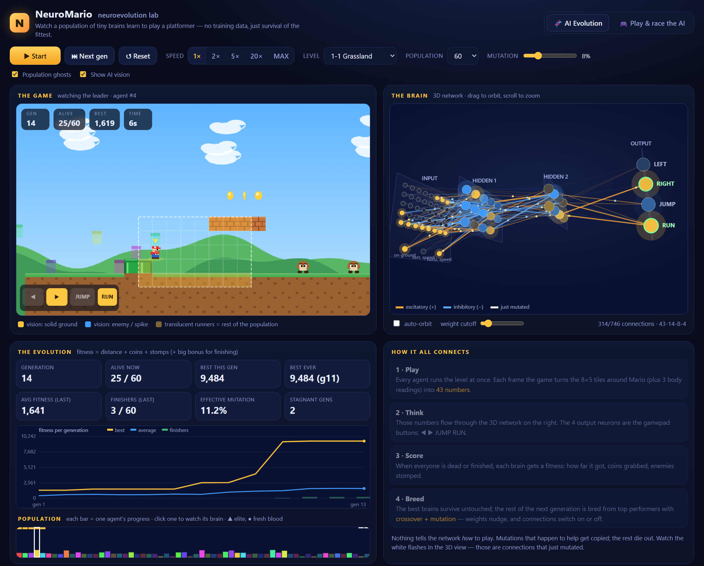
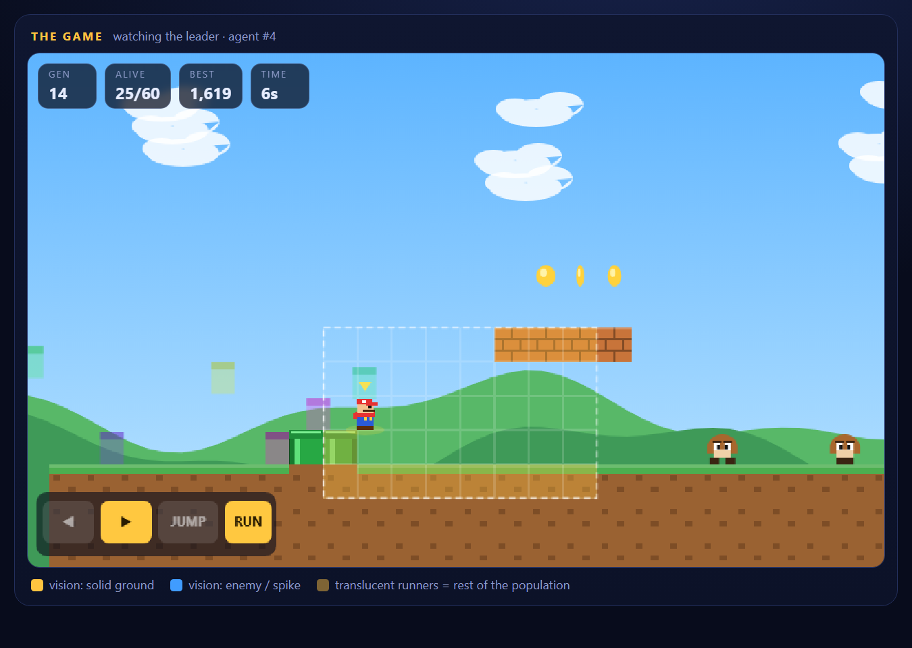
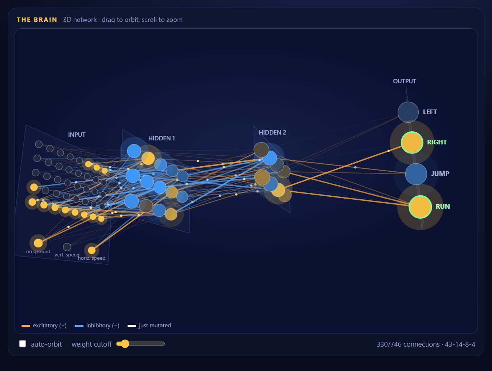
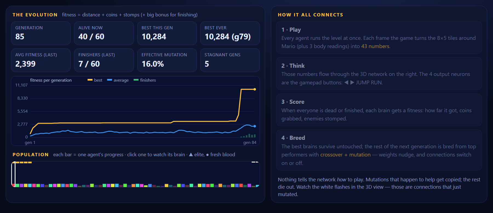

# NeuroMario — neuroevolution lab

A Mario-style platformer where a population of neural networks learns to play by evolution alone.
No dependencies, no build step: **open `index.html`** (or run `./serve.ps1` and visit http://localhost:8080).

<table>
  <tr>
    <td width="50%"> <b>The game</b> — the dashed grid is exactly what the network sees; the gamepad lights up with its output neurons; translucent runners are the rest of the population.</td>
    <td width="50%"> <b>The brain</b> — live 3D network: node colour = activation, orange/blue lines = excitatory/inhibitory weights, moving dots = signal flow.</td>
  </tr>
</table>

<b>The evolution</b> — level 1-2 stays stuck for ~75 generations, then a lucky mutation breaks through and finishers start to appear.

## What's inside
| File | Role |
|---|---|
| `js/game.js` | Headless platformer: seeded procedural levels (3 themes), physics, goombas, spikes, pits, `?` blocks, coins, flag |
| `js/core.js` | Seeded RNG + `Genome` (feed-forward net `43-14-8-4` with per-connection on/off mask) |
| `js/evolution.js` | Population loop: evaluate → rank → elites → tournament selection → crossover → mutation (weights *and* topology) |
| `js/render.js` | Game renderer, "AI vision" overlay, on-screen gamepad that mirrors the output neurons |
| `js/viz3d.js` | Interactive 3D network (orbit / zoom / hover), live activations, signal pulses, mutation flashes |
| `js/main.js` | Fixed 60 Hz clock, UI wiring, charts, play-vs-AI mode |

## How the pieces connect
1. **Game → network**: the 8×5 tiles around Mario (solid / enemy / spike / coin) + on-ground, vertical and horizontal speed = 43 inputs. The dashed grid on the game screen is exactly the input layer in 3D.
2. **Network → game**: 4 outputs (◀ ▶ JUMP RUN) press the virtual gamepad.
3. **Fitness**: distance + coins + stomps, plus a large bonus for finishing quickly.
4. **Evolution**: top 8 % survive unchanged, the rest are bred from the top 40 % (crossover + Gaussian mutation + connection toggling), 4 % fresh random brains. Mutation rises automatically when progress stagnates.

## Controls
- **Start/Pause** (Space), **Next gen** (fast-forward to the end of the generation), **Reset**, speed 1×–MAX, level, population, mutation rate.
- Click a bar in *Population* to pin that agent's brain in 3D; *follow leader* releases it.
- **Play & race the AI** tab: arrows/WASD + Space (jump), Shift/Z (run), R restart — you race the best evolved champion as a ghost.
- 3D: drag to orbit, scroll to zoom, double-click to reset, hover a node for its value, slider hides weak connections.

Typical results: level 1 is usually solved within ~10–30 generations; level 2 shows a long plateau followed by a breakthrough; level 3 is a real challenge.

## Demo URL parameters
Handy for sharing a specific moment (and how the screenshots above were made):
`index.html?level=1&seed=3&warmup=85&frames=200&pause=1` — pick a level and seed, pre-evolve 85 generations instantly, run 200 frames into the next one, and pause. Add `&only=game|brain|stats` to show a single panel.
